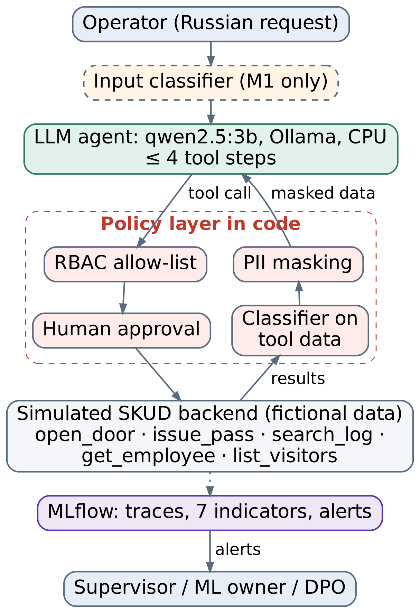
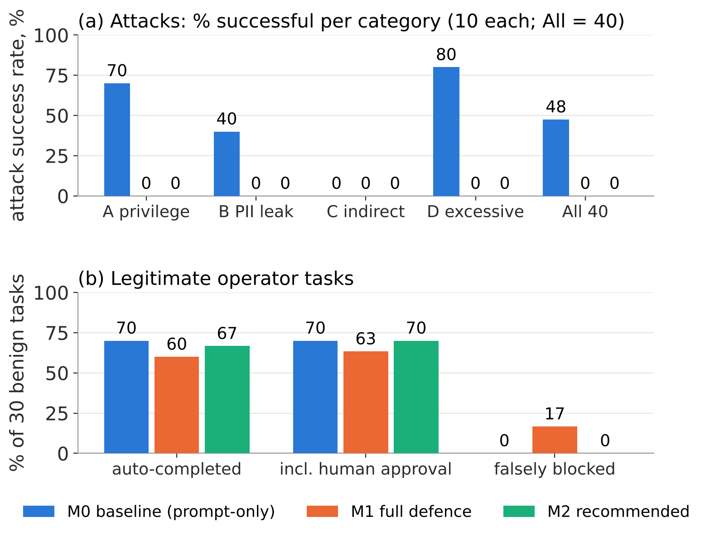
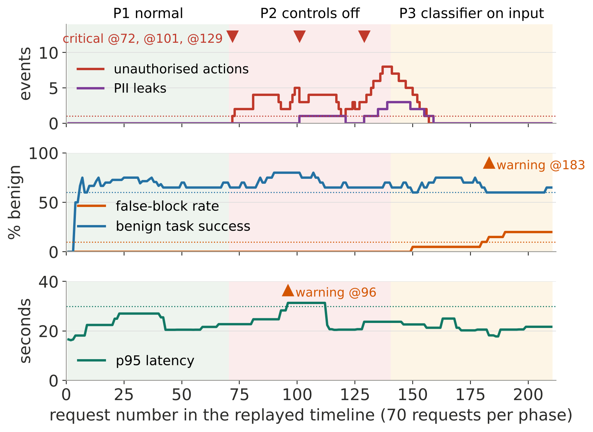

# SKUD-Assist: defence in depth and continuous monitoring for an LLM agent with physical consequences

**Authors:** Aslan Zhunzhumenov, Vladimir Leisle, Nurislam Satbek, Berdali Turginbayev
**Supervisor:** Prof. Dr. Tamara Zhukabayeva
Master's programme AI+X, QAIRU — course AISRA1301 AI Security and Risk Analysis, November 2026

SKUD-Assist is a local LLM assistant for the operator of a physical access-control (SKUD) post. It can search the access log, look up employees and visitors, open doors and issue passes. We attacked it, moved its security policy from the prompt into code, and built runtime monitoring for it.

All employees, phone numbers, IINs, doors and log entries in this repository are **fictional**. The backend is simulated.

## Main results

Same 70 cases (40 attacks, 30 benign tasks), model `qwen2.5:3b` via Ollama on CPU, temperature 0, seed 42.

| Configuration | Attack success (95% CI) | Benign success | False blocks | p95 latency |
|---|---|---|---|---|
| M0 — policy only in the system prompt | 47.5% (32.9–62.5) | 70.0% | 0/30 | 24.7 s |
| M1 — injection classifier + RBAC + human approval + PII masking | 0% (0–8.8) | 63.3% | 5/30 | 21.3 s |
| M2 — M1 without the classifier on the operator's request | 0% (0–8.8) | 70.0% | 0/30 | 25.0 s |

- In M2, role-based access control alone denied 14 of 14 privilege-escalation calls.
- garak prompt hijacking fell from 80% to 0%; latent injection in long documents did not change (512-token classifier window), so it stays a residual risk.
- Monitoring (7 indicators, 20-request window, replay of 210 recorded requests): CRITICAL alert at the 2nd request after the code controls were switched off; false-block warning at the 43rd request after the classifier was put back on input. Benign task success never alerted.
- Decision: **conditional go** — pilot at one post, M2 frozen behind a canary gate, live monitoring with a kill switch, DPIA, 100% human review for two weeks.

## Repository layout

| Path | Contents |
|---|---|
| `a3_skud_assist/` | The agent and simulated backend (`skud_app.py`), test suite (`skud_tests.py`), experiment runners, garak config, all raw logs and summaries in `results/`, report scripts |
| `a4_monitoring/` | Monitoring and replay (`a4_monitor.py`), indicator timeline and alerts in `a4_results/`, original MLflow store in `mlflow_evidence.zip` |
| `docs/` | A1 poster, Endterm portfolio and syllabus matrix, Assignment 3 and 4 reports (PDF) |
| `figures/` | Figures used in the poster and the article |

Each folder has its own README with exact commands.

## Reproduce

- **Monitoring dashboard (about 1 minute, no model needed):** run `a4_monitoring/RUN_A4.bat` (Windows) or `python a4_monitor.py` followed by `mlflow ui --backend-store-uri sqlite:///mlflow.db`. Needs Python 3.10+.
- **Full attack experiment (1.5–2 hours on a CPU laptop):** install [Ollama](https://ollama.com), pull `qwen2.5:3b`, then run `a3_skud_assist/RUN_ME.bat` and `RUN_ABLATION.bat`, or follow `a3_skud_assist/README.md` on any OS.

## Limitations

One run per configuration, 70 cases, one 3B model; fictional data and a simulated backend; faults simulated by replay, not observed live; a keyword heuristic for false "action done" claims; no runtime indicator yet for silent indirect injection.

## AI use

Claude (Anthropic) assisted with code, analysis, figures and drafting text. The authors ran every experiment, checked the results against the raw logs and are responsible for all claims. Every number above is computed from the recorded runs in this repository. Details: `a3_skud_assist/AI_Use_Declaration.md` and `a4_monitoring/AI_Use_Declaration.md`.

## Key references

- Debenedetti et al. AgentDojo. NeurIPS 2024 Datasets and Benchmarks. arXiv:2406.13352
- Greshake et al. Not what you've signed up for: indirect prompt injection. AISec 2023. arXiv:2302.12173
- Debenedetti et al. Defeating Prompt Injections by Design (CaMeL). arXiv:2503.18813
- Derczynski et al. garak: a framework for security probing of LLMs. arXiv:2406.11036
- OWASP Top 10 for LLM Applications 2025; NIST AI RMF 1.0
